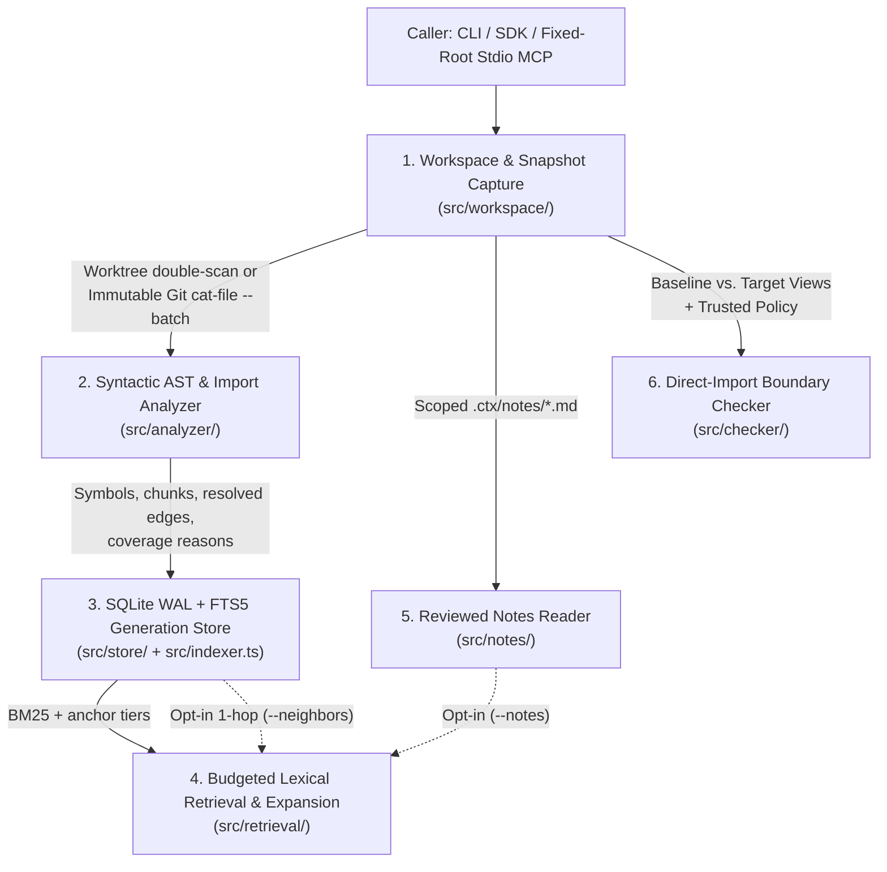

# Architecture & Tradeoffs

`ctx-gate` is structured as a single-package TypeScript/ESM library, CLI (`ctxgate`), and stdio Model Context Protocol (`MCP`) server. Every architectural choice follows a strict rule: **add complexity only when a simpler deterministic mechanism fails an explicit measurement.**

---

## 1. System Architecture Overview



### The Six Core Modules

| Module | Source Path | Responsibility |
| :--- | :--- | :--- |
| **1. Contracts & Schemas** | [`src/contracts/index.ts`](src/contracts/index.ts) | Strict Zod v4 schemas for `.ctx/config.json`, provenance references (`ReferenceSchema`), coverage diagnostics, context/expand payloads, and checker reports. |
| **2. Workspace & Snapshot Capture** | [`src/workspace/initialize.ts`](src/workspace/initialize.ts)<br>[`src/workspace/snapshot.ts`](src/workspace/snapshot.ts)<br>[`src/workspace/git.ts`](src/workspace/git.ts) | Canonical root resolution, symlink/submodule/credential exclusion, hierarchical `.gitignore` evaluation, worktree double-scan verification, and immutable commit capture via `git ls-tree -r -z` and byte-framed `git cat-file --batch`. |
| **3. Syntactic Analyzer** | [`src/analyzer/index.ts`](src/analyzer/index.ts) | TypeScript AST parsing (`ts.createSourceFile`), declaration/method/class/interface/type/enum symbol extraction, 80-line source chunking, and deterministic module resolution over the captured view without `ts.Program` or `ts.sys`. |
| **4. SQLite/FTS5 Store & Indexer** | [`src/store/index.ts`](src/store/index.ts)<br>[`src/indexer.ts`](src/indexer.ts) | Built-in `node:sqlite` (`WAL` mode + `FTS5` virtual table). Reuses AST facts when file content hashes are unchanged, publishes generations atomically inside `BEGIN IMMEDIATE`, and quarantines/rebuilds corrupt cache files automatically. |
| **5. Retrieval, Focus & Budget Packer** | [`src/retrieval/index.ts`](src/retrieval/index.ts)<br>[`src/retrieval/query.ts`](src/retrieval/query.ts)<br>[`src/retrieval/focus.ts`](src/retrieval/focus.ts)<br>[`src/retrieval/budget.ts`](src/retrieval/budget.ts)<br>[`src/retrieval/neighbors.ts`](src/retrieval/neighbors.ts)<br>[`src/notes/index.ts`](src/notes/index.ts) | Safe query normalization (never raw SQL/FTS syntax), tiered candidate ranking, Lexical `v2` intra-symbol window focusing, full-envelope token/byte packing, hash-verified `expand()`, opt-in 1-hop import neighbors, and opt-in reviewed Markdown notes. |
| **6. Boundary Checker & Interfaces** | [`src/checker/index.ts`](src/checker/index.ts)<br>[`src/mcp/index.ts`](src/mcp/index.ts)<br>[`src/cli/index.ts`](src/cli/index.ts)<br>[`src/cli/doctor.ts`](src/cli/doctor.ts) | Syntactic `deny_import` enforcement across baseline/target views with stateless cursor pagination, CLI entrypoints, environment `doctor`, and fixed-root stdio MCP server (`ctx_context`, `ctx_expand`, advisory `ctx_check`). |

---

## 2. Key Engineering Decisions & Tradeoffs

### D1: Built-in `node:sqlite` (Node 24 LTS) Instead of `better-sqlite3`
- **Problem:** `better-sqlite3` requires native bindings (`node-gyp rebuild` and Visual Studio C++ build tools on Windows when prebuilds miss).
- **Decision:** Target Node 24 LTS (`>=24 <25`) and use Node's built-in `node:sqlite` (`DatabaseSync`, SQLite `3.53.4` with `FTS5` and `WAL`).
- **Tradeoff:** Couples the runtime to Node 24+, but eliminates native C++ compilation failures and transitive binary supply-chain risk.

### D2: Syntactic AST + Captured-View Module Resolution Instead of `ts.Program`
- **Problem:** Constructing a full TypeScript `ts.Program` for typechecking/call graphs is slow (seconds to tens of seconds on medium repos) and fails whenever `node_modules` or generated types are incomplete.
- **Decision:** Parse individual files with `ts.createSourceFile` and resolve imports using `ts.resolveModuleName` backed strictly by the captured in-memory/snapshot view (`tsconfig.json` `paths`, `package.json` `exports`/`imports`, NodeNext conditions).
- **Tradeoff:** Cannot resolve dynamic computed imports (`import(variable)`), indirect call graphs, or inferred types. Instead, `ctx-gate` records those cases explicitly in `coverage.reasons` and fails closed (`exit 2`) in required boundary checks rather than guessing.

### D3: Full-Envelope Token & Byte Accounting
- **Problem:** Many retrieval tools count tokens only on raw code snippets while ignoring JSON keys, file paths, provenance hashes, and warnings—causing the actual tool response to exceed the caller's budget.
- **Decision:** `ctx-gate` measures the **complete compact JSON payload plus trailing newline** against both:
  1. `min(budget_tokens, remaining_tokens)` (default `2,000` for `context`, `1,000` for `expand`, max `4,000`), and
  2. `max_bytes` (default/max `16,384` UTF-8 bytes).
- **Tradeoff:** Exact token counting (`o200k_base` or `cl100k_base` via pure-JS `js-tiktoken`) adds ~450 ms of cold rank initialization per CLI process and repeated serialization checks during packing. Lexical `v2` bounds packing attempts to `40` candidates (down from `200` in `v1`), cutting mean tokenizer calls from `406.85` to `108.80` and warm `p95` latency from `3.96 s` to `1.86 s`.

### D4: Source-Bound Freshness Over Mutable Line Numbers
- **Problem:** Line numbers drift as soon as a file is edited.
- **Decision:** Every item returned by `context` includes a `Reference`:
  ```json
  {
    "schema_version": 1,
    "root_id": "<sha256-of-canonical-root>",
    "view_id": "<sha256-of-snapshot-inventory>",
    "path": "src/services/session.ts",
    "content_hash": "<sha256-of-file-bytes>",
    "start_line": 1,
    "end_line": 12
  }
  ```
  When `expand` is called with that reference, it checks the file's current SHA-256 hash. If the file was edited, `expand` returns `status: "stale_reference"`, provides an updated replacement reference, and **withholds the excerpt** so the agent never acts on stale lines.

### D5: Why `--neighbors` and `--notes` Are Off by Default
- **One-Hop Import Neighbors (`--neighbors`):** Follows resolved local imports one hop from the top 3 lexical seed files (prioritizing outgoing dependencies for general queries and incoming importers for usage/refactor queries, with a 25-importer hub-suppression threshold).
- **Reviewed Notes (`--notes`):** Reads `.ctx/notes/*.md` files with YAML 1.2 frontmatter (`review_status: accepted`, `reviewer`, `last_reviewed_revision`, `scopes`, and `evidence` bindings containing `path`, `content_hash`, and optional `symbol`). Notes never enter FTS5/BM25 statistics and carry independent freshness states (`current`, `needs_review`, `target_missing`, `unbound`).
- **Why Default-Off:** In the 20-case Phase 4 ablation study across 1,000, 2,000, and 4,000 token budgets (`240` total briefs), enabling neighbors (`G`), notes (`N`), or both (`GN`) **added 0 labeled source lines** while **displacing 9 to 40 labeled source lines** compared to pure Lexical `v2` (`L`). Even when a selected note was omitted for size, its omission metadata consumed token allowance. Therefore, both features remain explicit opt-ins.

### D6: Trusted Baseline Policy in `ctxgate check`
- **Problem:** If a boundary checker reads rules or `.gitignore` from the candidate working tree, an agent can make a failing check pass by deleting rules in `.ctx/config.json` or ignoring the violating directory.
- **Decision:** `ctxgate check` loads `roots`, `exclude`, `rules`, and `.gitignore` files from the **baseline commit** (or an explicit immutable `--policy-ref`), never from the candidate worktree. Candidate changes to `.ctx/config.json` are flagged with `candidate_policy_changed: true`.
- **Verdict Semantics:**
  - `exit 0`: Coverage is complete and `counts.new === 0` (existing baseline debt is reported in `counts.existing` but allowed).
  - `exit 1`: Required mode with `counts.new > 0`.
  - `exit 2`: Incomplete coverage (e.g., syntax error, unresolved local import in a rule source, missing Git object, or submodule overlap), invalid cursor, or missing rules in required mode.

---

## 3. Security & Isolation Boundaries

1. **Fixed-Root Stdio MCP Server (`src/mcp/index.ts`)**
   - Bound to one canonical repository root at startup (`ctxgate mcp --root <repo>`).
   - Rejects any tool input attempting to pass a `root`, `policy`, `policy_file`, or `mode: "required"`.
   - `ctx_check` over MCP is strictly `advisory`—CI enforcement must use the CLI with immutable 40/64-hex commit SHAs ([`.github/workflows/boundary-check.yml`](.github/workflows/boundary-check.yml)).
2. **Untrusted Repository Content**
   - Query text is tokenized into safe parameter bindings and never interpolated into raw SQL or raw FTS5 operators.
   - YAML note frontmatter is parsed with YAML 1.2 core schemas rejecting duplicate keys, aliases, and explicit tags.
   - Symlinks, gitlinks/submodules, traversal paths (`..`), and common credential filenames (`.env*`, `*.pem`, `*.key`, `id_rsa*`, `.npmrc`, `.netrc`) are excluded during discovery.

---

## 4. Rejected Alternatives

| Alternative | Why It Was Rejected |
| :--- | :--- |
| **Background File Watcher / Daemon** | Adds background process lifecycle bugs, orphaned locks on Windows, and stale-state races. Full double-hashed worktree refresh takes `~245–487 ms` on small repos and `~1.7 s` on 1,006 files. |
| **Local or Remote Vector Embeddings** | Adds external API keys or multi-hundred-MB local model weights and non-deterministic hardware behavior without fixing within-function span selection. |
| **Multi-Hop Transitive Dependency Graph in Retrieval** | Even 1-hop neighbors displaced useful lexical spans at 2,000 tokens; 2+ hops explode candidate fan-out on shared utility modules. |
| **Automatic Agent-Approved Notes** | Allowing an agent to mark its own notes `accepted` creates a self-reinforcing hallucination loop. Notes require explicit human review provenance and SHA-256 evidence bindings. |
